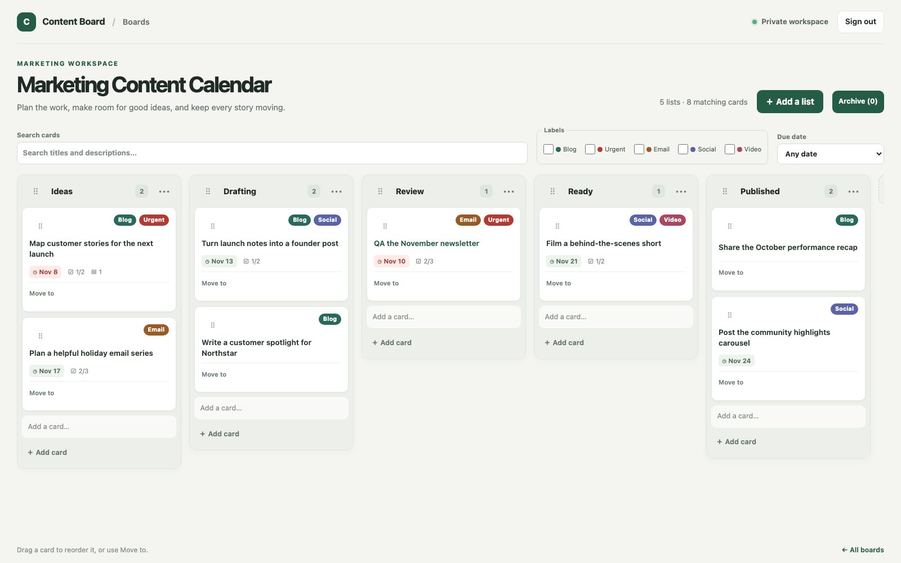

# Cadence

A private content-planning board for marketing teams and creators.

**Product inspiration:** Trello-inspired boards and cards for content planning, with its own Cadence branding.

**Neander library:** Cadence · **Category:** Marketing



## What you can build

- Organize content in boards and lists with draggable cards.
- Track labels, due dates, checklists and comments.
- Search and filter cards, archive completed work and manage private boards.
- Create an account with its own private starter board.

## How this fits into Neander

This is the open-source app behind Neander’s **Cadence** starter. You can
run and modify it on its own without a Neander account, or use it as a starting
point in Neander.

1. Choose **Use Template** in [Neander](https://neander.ai).
2. Neander creates a normal project from a registered version of this repository,
   with fresh Git history, and publishes a working app with sample data.
3. Open the live app and continue in the project. Prompt Neander to make changes
   in the codebase, just as you would in any other project.
4. Use **Publish** again when you want your changes reflected in the live app.

Your project starts from one version. Later changes to this repository or the
template library do not overwrite your project. Linked IDE projects use their
checkout; web projects use Neander’s managed project source.

## Run locally

Stack: Next.js, React, TypeScript, PostgreSQL, Drizzle, Better Auth and dnd-kit.

Use **Node 24.22.3** and **pnpm 11.18.0**. Versions are listed in
`mise.toml`; if you use mise, run `mise install`. Install Docker for the local
PostgreSQL service.

### 1. Install the app

```sh
git clone https://github.com/neanderhq/cadence.git
cd cadence
pnpm install --frozen-lockfile
cp .env.example .env.local
```

### 2. Start local PostgreSQL

```sh
PGPORT=55434 docker compose -p cadence-dev -f compose.dev.yaml up -d --wait
```

The example database URL uses port `55434`. The Compose project name keeps
this app’s development data separate from other checkouts.

### 3. Configure the app

Edit `.env.local`. The database URL is already set for the local service above.

| Variable | Purpose |
| --- | --- |
| `DATABASE_URL` | PostgreSQL connection used by this local app. |
| `BETTER_AUTH_URL` | The browser origin, initially `http://127.0.0.1:3000`. |
| `BETTER_AUTH_SECRET` | A random authentication secret. |
| `DEMO_OWNER_PASSWORD` | A password of at least 12 characters for the fictional demo account. |

Generate a value for each blank secret and paste it into the environment file:

```sh
node -e "console.log(require('node:crypto').randomBytes(32).toString('base64url'))"
```

These database credentials are for the loopback development service. Neander
supplies a managed database connection and generated runtime secrets when it
publishes a project. Keep your local environment file out of Git.

### 4. Initialize and start

```sh
node --env-file=.env.local .neander/migrate.mjs
node --env-file=.env.local .neander/seed.mjs
pnpm dev
```

Open **http://127.0.0.1:3000**.

Sign in as **`maya.chen@example.invalid`** with your `DEMO_OWNER_PASSWORD`.
You can also create your own account; signup creates a separate private starter board.

### Try the content flow

Open **Marketing Content Calendar**, drag a card into another list, edit its title or checklist, and refresh to see the saved state.

## Sample data

A fictional Marketing Content Calendar with five lists, eight cards, labels, checklists and a comment.

All sample people, organizations and responses are fictional. Seed retries preserve
existing changes and credentials. Normal app restarts do not reset your data.

## Development and checks

```sh
pnpm check
pnpm test
pnpm build
```

Public CI runs these app checks and a production build without Neander’s private
publishing tools or cloud credentials. Full template image/database verification
and library publication are run manually by Neander maintainers in private CI.
Merging a contribution does not automatically update the template library.

## Repository layout

| Path | Purpose |
| --- | --- |
| `app/` | Private board UI, login/signup and API routes. |
| `server/` | Board ownership, persistence and authentication. |
| `drizzle/` | Versioned PostgreSQL migrations. |
| `.neander/template.yaml` | Library metadata and install/check/test/seed commands. |
| `.neander/compose.yaml` | Normal Neander Publish recipe and runtime requirements. |
| `.neander/seed.mjs` | Fictional demo initializer. |
| `scripts/verify-template.mjs` | Maintainer verification of the built app image. |

## Maintaining the Neander template

The `.neander/template.yaml` manifest defines the library entry and verification
commands. `.neander/compose.yaml` defines the app’s normal Publish recipe,
including PostgreSQL, migrations and generated secrets. Keep these files in sync
when changing database, authentication or runtime requirements.

Neander’s private release workflow checks out an exact GitHub commit, verifies
the built app with a disposable database, and registers its image and metadata.
The application source stays in this repository.

## Contributing

Fork the repository, make a focused change, and run the checks above before
opening a pull request. Include the behavior you changed and how you verified it.
A maintainer decides when to publish a new version to Neander’s library.

Originally built by Ibrahim on Neander.

## License

[MIT](LICENSE). Third-party components retain their respective licenses and
existing attribution notices.

## Security

See [SECURITY.md](SECURITY.md) for private vulnerability reporting and the automated security checks.
